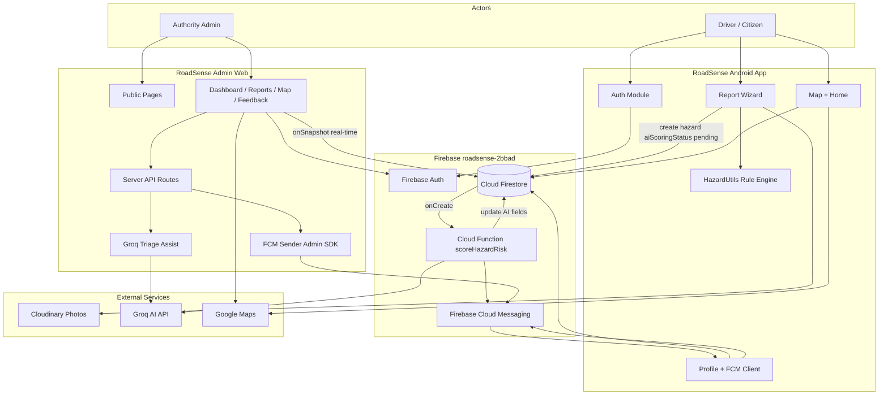

# RoadSense — System Architecture

**Project:** Crowdsourced Road Hazard Reporting and Monitoring System  
**Course:** ICT602 Mobile Programming  
**Institution:** Universiti Teknologi MARA (UiTM)  
**Shared backend:** Firebase project `roadsense-2bbad`  
**Repositories:** [RoadSense Mobile](https://github.com/HarlequinCS/RoadSense) · [RoadSense Admin](https://github.com/HarlequinCS/RoadsenseAdmin)  
**Last updated:** 18 July 2026

This document describes how the **Android mobile app** and **web admin dashboard** connect through a shared Firebase backend. No credentials or secrets are included — safe for reports, viva, and architecture diagrams.

---

## Table of contents

1. [High-level system view](#1-high-level-system-view)
2. [Two halves, one system](#2-two-halves-one-system)
3. [Deployment topology](#3-deployment-topology)
4. [Mobile app modules](#4-mobile-app-modules)
5. [Admin dashboard pages](#5-admin-dashboard-pages)
6. [Firestore data model](#6-firestore-data-model)
7. [Hazard report flow](#7-hazard-report-flow-end-to-end)
8. [AI architecture](#8-ai-architecture)
9. [Authentication](#9-authentication-architecture)
10. [Push notifications (FCM)](#10-push-notifications-fcm)
11. [External services](#11-external-services)
12. [Admin server API routes](#12-admin-server-api-routes)
13. [Real-time sync](#13-real-time-sync-pattern)
14. [Community verification](#14-community-verification-model)
15. [Diagram building blocks](#15-suggested-diagram-blocks)
16. [Mermaid diagram](#16-mermaid-diagram)
17. [One-line summary](#17-one-line-summary)

---

## 1. High-level system view

```
┌─────────────────────────────────────────────────────────────────────────────┐
│                              INTERNET / USERS                                │
└─────────────────────────────────────────────────────────────────────────────┘
         │                                    │
         │ Android users                      │ Authority staff (admins)
         ▼                                    ▼
┌─────────────────────┐              ┌─────────────────────┐
│   MOBILE APP        │              │   ADMIN WEB APP      │
│   (Citizen-facing)  │              │   (Authority-facing) │
│                     │              │                      │
│  Java + XML         │              │  Next.js 16 + TS     │
│  Material Design    │              │  Tailwind CSS        │
│  Google Maps SDK    │              │  Recharts            │
└─────────┬───────────┘              └──────────┬───────────┘
          │                                     │
          │         Firebase Client SDK         │
          │         (Auth + Firestore + FCM)    │
          └─────────────────┬───────────────────┘
                            ▼
          ┌─────────────────────────────────────────┐
          │           FIREBASE (Google Cloud)          │
          │  ┌─────────┐ ┌──────────┐ ┌─────────────┐ │
          │  │  Auth   │ │ Firestore│ │     FCM     │ │
          │  └─────────┘ └──────────┘ └─────────────┘ │
          │  ┌─────────────────────────────────────┐  │
          │  │   Cloud Functions (asia-southeast1)  │  │
          │  │   scoreHazardRisk (Groq AI + FCM)    │  │
          │  └─────────────────────────────────────┘  │
          └─────────────────────────────────────────┘
                            │
          ┌─────────────────┼─────────────────┐
          ▼                 ▼                 ▼
   ┌────────────┐    ┌────────────┐    ┌────────────┐
   │ Cloudinary │    │  Groq API  │    │ Google Maps│
   │  (photos)  │    │  (AI LLM)  │    │  (maps)    │
   └────────────┘    └────────────┘    └────────────┘
```

---

## 2. Two halves, one system

| Layer | Mobile app | Admin dashboard |
|-------|------------|-----------------|
| **Users** | Drivers / citizens | Authority staff |
| **Platform** | Android (Java + XML) | Web (Next.js, Docker on VPS) |
| **Purpose** | Report, map, verify hazards | Investigate, manage, analyze |
| **Auth** | Email + Google Sign-In | Email + admin custom claim |
| **Writes hazards** | Create, verify, resolve | Status, notes, priority override, delete |
| **Unique admin action** | — | Set **Under Investigation** |

Both apps read and write the **same Firestore database** in real time.

---

## 3. Deployment topology

```
                    ┌──────────────┐
                    │  Cloudflare  │  (optional CDN / DNS)
                    └──────┬───────┘
                           │ HTTPS
                           ▼
                    ┌──────────────┐
                    │    nginx     │  Reverse proxy, TLS, security headers
                    │  (port 443)  │
                    └──────┬───────┘
                           │ http://127.0.0.1:3010
                           ▼
                    ┌──────────────┐
                    │    Docker    │  roadsense-admin container
                    │  Next.js     │  Standalone Node server
                    └──────┬───────┘
                           │
         ┌─────────────────┼─────────────────┐
         ▼                 ▼                 ▼
   Firebase Auth    Firebase Firestore   Groq API
   (client + REST)   (client SDK)        (server-side only)
   FCM (Admin SDK)   Cloudinary (read URLs)

Mobile app ──► Firebase / Cloudinary / Google Maps directly (no VPS)
```

| Component | Detail |
|-----------|--------|
| **Public URL** | `https://roadsense.saifuliqbal.dev` |
| **Admin container** | Docker Compose, port 3010 → nginx |
| **Mobile** | APK installed on device; connects to Firebase directly |

---

## 4. Mobile app modules

| # | Module | Main responsibility |
|---|--------|---------------------|
| 1 | **Authentication** | Email/Google login, legal gate, onboarding |
| 2 | **Home dashboard** | Nearby alerts, hazard list, mini-map, pull-to-refresh |
| 3 | **Hazard reporting** | 5-step wizard, photo, GPS, duplicate check, offline queue |
| 4 | **Hazard map** | Full-screen map, filters, heat map, hazard detail sheet |
| 5 | **User profile** | Stats, badges, My Reports, leaderboard, feedback, settings |
| 6 | **About** | Team, terms, privacy |

**Background services:**

- Firebase Cloud Messaging (FCM) — push alerts
- `HazardProximityService` — background location monitoring
- Arrival prompts at **150 m** — confirm or resolve hazards in-app

**Tech stack (mobile):**

```
Android (Java + XML)
  → Firebase Auth (Email + Google Sign-In)
  → Cloud Firestore (users, hazards, feedback)
  → Firebase Cloud Functions + Groq (AI risk scoring)
  → Firebase Cloud Messaging (push alerts)
  → Firebase Analytics + Crashlytics
  → Google Maps + Location Services + Heatmap
  → Cloudinary (hazard photos)
```

---

## 5. Admin dashboard pages

| Route | Function |
|-------|----------|
| `/` | Public landing page |
| `/about` | Project story, team, tech stack |
| `/login` | Admin sign-in |
| `/dashboard` | Overview stats, charts, recent reports |
| `/reports` | Hazard queue, filters, bulk actions, CSV export |
| `/reports/[id]` | Detail view, AI panel, admin override, push notify |
| `/map` | Full-screen hazard map |
| `/users` | User profiles, stats, per-user reports |
| `/feedback` | In-app feedback inbox |
| `/notifications` | Broadcast / targeted FCM push |
| `/analytics` | Trends, charts, AI summary |
| `/activity` | Admin audit log |

**Tech stack (admin):**

```
Next.js 16 + TypeScript + Tailwind CSS
  → Firebase Auth + Firestore (client SDK)
  → Server API routes (Groq AI, FCM, session)
  → Google Maps (@react-google-maps/api)
  → Recharts
  → Docker + nginx deployment
```

---

## 6. Firestore data model

### Collection: `hazards/{hazardId}`

| Field group | Fields | Written by |
|-------------|--------|------------|
| **Identity** | `userId`, `reporterName` | Mobile |
| **Content** | `hazardType`, `description`, `imageUrl` | Mobile |
| **Location** | `latitude`, `longitude`, `geohash` | Mobile |
| **Lifecycle** | `status`, `verificationCount`, `verifiedBy`, `resolvedBy`, `followers` | Mobile + Admin |
| **Risk** | `riskLevel`, `ruleBasedRiskLevel`, `aiRiskLevel`, `aiReason`, `aiConfidence`, `riskSource` | Mobile → AI → Admin |
| **AI pipeline** | `aiScoringStatus`, `aiScoredAt` | Mobile (pending) → AI (complete) |
| **Admin** | `adminNotes`, `adminUpdatedBy`, `adminUpdatedAt` | Admin |
| **Timestamps** | `createdAt`, `statusUpdatedAt` | Mobile / Admin |

#### Hazard types

`Pothole` · `Road Crack` · `Flooding` · `Debris` · `Street Light Issue` · `Other`

#### Status values

| Status | Set by |
|--------|--------|
| `New` | Mobile app on submit |
| `Under Investigation` | **Admin only** |
| `Resolved` | Mobile app or admin |

#### Risk levels

`Low` · `Medium` · `High` · `Critical`

#### Risk source

| `riskSource` | Meaning |
|--------------|---------|
| `rules` | Phone rule engine (interim, on submit) |
| `ai` | Groq AI scoring (Cloud Function or admin worker) |
| `admin` | Manual priority override by authority staff |

#### AI scoring status

| `aiScoringStatus` | Meaning |
|-------------------|---------|
| `pending` | Waiting for AI |
| `complete` | AI finished successfully |
| `failed` | AI error; rule-based risk kept |

---

### Collection: `users/{uid}`

| Fields | Purpose |
|--------|---------|
| `fullName`, `email`, `birthday`, `gender`, `photoUrl` | Profile |
| `totalReports`, `resolvedReports`, `verifiedReports`, `highRiskReports` | Statistics |
| `contributorBadge` | Gamification tier |
| `fcmTokens[]` | Multi-device push notification tokens |
| Alert preferences | Hazard alerts on/off |

**Contributor badges:** `New Reporter` → `Active Reporter` → `Road Guardian` → `Safety Hero`

---

### Collection: `feedback/{id}`

| Fields | Purpose |
|--------|---------|
| `userId`, `userName`, `email`, `message`, `rating`, `category`, `appVersion` | In-app user feedback |

| Access | Rule |
|--------|------|
| **Create** | Signed-in mobile users |
| **Read** | Admins only |
| **Update/Delete** | Not allowed |

---

### Collection: `audit_log/{id}`

| Fields | Purpose |
|--------|---------|
| `action`, `hazardId`, `adminUid`, `adminEmail`, `details`, `createdAt` | Admin accountability trail |

Append-only. Actions include: `status_change`, `risk_override`, `notes_updated`, `hazard_deleted`, `bulk_status_change`.

---

## 7. Hazard report flow (end-to-end)

```
MOBILE                          FIRESTORE                    AI + NOTIFY
──────                          ─────────                    ───────────

1. User completes
   5-step wizard
        │
2. Photo ──────────────────► Cloudinary
   (compressed)              (returns imageUrl)
        │
3. Rule engine computes
   ruleBasedRiskLevel
   (HazardUtils on phone)
        │
4. Write hazard doc ───────► hazards/{id}
   status: New              • riskLevel = rule-based (interim)
   aiScoringStatus: pending • riskSource: rules
        │                        │
        │                        ├──► Cloud Function (onCreate)
        │                        │         scoreHazardRisk
        │                        │              │
        │                        │              ▼
        │                        │         Groq API (text + optional vision)
        │                        │              │
        │                        ◄──────────────┘
        │                        • riskLevel updated
        │                        • aiScoringStatus: complete
        │                        • riskSource: ai
        │                        • aiReason, aiConfidence filled
        │                              │
        │                              ▼
        │                         FCM → reporter + followers
        │
5. Real-time listener ◄────── Firestore update
   Home / Map refresh
        │
ADMIN (parallel path)
        │
6. Admin sees report ───────► onSnapshot (live updates)
   in /reports
        │
7. Admin actions:
   • Set Under Investigation
   • Override priority (riskSource: admin)
   • Add admin notes
   • Send push notification
   • Delete report
```

**Offline support (mobile):** Reports queue locally and upload when connectivity returns.

**Duplicate detection (mobile):** Same hazard type within 100 m triggers a warning before submit.

**Rate limit (mobile):** Maximum 5 reports per hour per user.

---

## 8. AI architecture

RoadSense uses a **rules-first, AI-second** priority model.

### Step 1 — Rule-based (instant, on phone)

`HazardUtils` computes `ruleBasedRiskLevel` using:

- Base tier by hazard type (e.g. Flooding starts higher)
- +1 tier if 3+ hazards within 500 m
- +1 tier if same type within 200 m

Saved immediately so the hazard appears with a badge everywhere.

### Step 2 — AI scoring (async, server-side)

| Path | Trigger | Runs on | Updates Firestore? |
|------|---------|---------|-------------------|
| **A. Cloud Function** | Hazard `onCreate` | Firebase Functions (`scoreHazardRisk`) | Yes |
| **B. Admin worker** | Admin dashboard open | `PendingHazardScorer` component | Yes |
| **C. Admin triage** | Admin clicks in UI | `/api/ai/triage` (Groq) | No — suggestion only |

**Groq models used:**

| Use case | Model |
|----------|-------|
| Text-only scoring | `llama-3.3-70b-versatile` |
| Photo + text scoring | `meta-llama/llama-4-scout-17b-16e-instruct` (vision) |
| Admin analytics summary | `llama-3.1-8b-instant` |

**Security rule:** Groq API keys exist only on the server (admin `.env` and Firebase Functions secrets). Never in the mobile app or browser.

### AI output fields written to Firestore

```
riskLevel          → final priority shown everywhere
aiRiskLevel        → AI suggestion
aiReason           → short explanation
aiConfidence       → 0.0–1.0
riskSource         → "ai"
aiScoringStatus    → "complete"
aiScoredAt         → timestamp
```

---

## 9. Authentication architecture

```
┌─────────────────────────────────────────────────────────┐
│                    Firebase Authentication               │
│  • Email / password                                      │
│  • Google Sign-In                                        │
│  • Custom claim: { admin: true } for authority staff     │
└─────────────────────────────────────────────────────────┘
          │                              │
          ▼                              ▼
   MOBILE CLIENT                   ADMIN WEB
   • Firebase Auth SDK             • Firebase Auth SDK (login)
   • ID token stored in app        • Session cookie (httpOnly)
   • Firestore rules:              • Middleware guards admin routes
     isSignedIn()                  • API routes verify Bearer token
   • Can create hazards           • Requires admin custom claim
   • Can verify community fields   • Full hazard/user write access
```

### Firestore security rules summary

| Collection | Mobile user | Admin |
|------------|-------------|-------|
| `hazards` | Read; create; update verification fields only | Full update; delete |
| `users` | No direct access | Read; write |
| `feedback` | Create | Read |
| `audit_log` | No access | Read; create (append-only) |

Rules file: `firestore.rules` in the admin repository (deploy via Firebase Console).

---

## 10. Push notifications (FCM)

| Event | Triggered by | Recipients |
|-------|--------------|------------|
| AI scoring complete | Cloud Function or admin API | Reporter + hazard followers |
| Admin status change | Admin API (on report save) | Reporter + followers |
| Admin broadcast | `/notifications` page | All users with registered tokens |
| Proximity alert | Mobile background service | Device owner |
| Arrival prompt (150 m) | Mobile foreground service | In-app dialog on Home/Map |

**Token storage:** `users.fcmTokens[]` — supports multiple devices per user.

**Admin FCM sender:** Firebase Admin SDK on the server (service account JSON in server environment only).

---

## 11. External services

| Service | Used by | Purpose |
|---------|---------|---------|
| **Firebase Auth** | Mobile + Admin | User identity |
| **Cloud Firestore** | Mobile + Admin + Functions | Real-time NoSQL database |
| **Firebase Cloud Messaging** | Functions + Admin server | Push notifications |
| **Firebase Cloud Functions** | Firestore trigger | AI scoring + auto FCM |
| **Firebase Analytics** | Mobile | Usage tracking |
| **Firebase Crashlytics** | Mobile | Crash reporting |
| **Cloudinary** | Mobile (upload), Admin (display) | Hazard photo storage and CDN |
| **Google Maps Platform** | Mobile + Admin | Map display and geolocation |
| **Groq API** | Cloud Function + Admin server | LLM hazard scoring and admin assist |
| **OpenStreetMap Nominatim** | Admin only | Reverse geocoding on report detail |

---

## 12. Admin server API routes

All routes require admin authentication unless noted. Secrets stay server-side only.

| Endpoint | Method | Purpose |
|----------|--------|---------|
| `/api/auth/session` | POST / DELETE | Create or clear httpOnly session cookie |
| `/api/ai/score-hazard` | POST | Groq score one hazard document |
| `/api/ai/triage` | POST | Groq triage suggestion for admin |
| `/api/ai/analyze-photo` | POST | Groq vision analysis of hazard photo |
| `/api/ai/analytics-summary` | POST | Groq executive analytics narrative |
| `/api/notifications/send` | POST | Send FCM push (custom, status, AI complete, broadcast) |

---

## 13. Real-time sync pattern

Both apps use Firestore **`onSnapshot`** listeners — no polling required.

```
Firestore document change
        │
        ├──► Mobile HomeDashboard   (badge + list refresh)
        ├──► Mobile HazardMap       (marker refresh)
        ├──► Admin ReportTable      (queue refresh)
        ├──► Admin Report detail    (AI spinner stops)
        ├──► Admin Dashboard stats  (counts refresh)
        └──► Admin Sidebar badge    (new report count)
```

When admin changes a hazard status or AI completes scoring, mobile users see the update without restarting the app.

---

## 14. Community verification model

```
Driver A reports hazard ──► hazards/{id}   status: New
                                    │
Driver B confirms     ──► verifiedBy[] updated, verificationCount++
                                    │
Driver C at 150 m     ──► In-app dialog: "Still there?" / "Resolved?"
                                    │
Driver follows hazard ──► followers[] updated → receives push on status/AI change
                                    │
Admin investigates  ──► status: Under Investigation
                                    │
Road fixed            ──► status: Resolved
                          (hidden from map, kept in Firestore for records)
```

**Resolved hazards:** Stay in Firestore for statistics and audit. Hidden from active map and home lists. Visible in mobile **My Reports → Resolved** tab.

---

## 15. Suggested diagram blocks

Use these **7 boxes** for a clean architecture slide or poster:

| # | Box label | Contents |
|---|-----------|----------|
| 1 | **RoadSense Android App** | 6 modules, Maps, Camera, FCM client, offline queue |
| 2 | **RoadSense Admin Web** | Next.js, Docker, nginx, dashboard pages |
| 3 | **Firebase Platform** | Auth, Firestore, FCM, Cloud Functions |
| 4 | **Cloudinary** | Hazard photo CDN |
| 5 | **Groq AI** | Hazard scoring + admin triage assist |
| 6 | **Google Maps** | Map tiles + GPS |
| 7 | **Actors** | Drivers (citizens) · Authority admins |

### Arrows to draw

| From | To | Label |
|------|----|-------|
| Mobile | Firestore | Read/write (bidirectional, real-time) |
| Mobile | Cloudinary | Upload photo |
| Firestore | Cloud Function | `onCreate` trigger |
| Cloud Function | Groq | Score hazard |
| Cloud Function | Firestore | Write AI fields |
| Cloud Function | FCM | AI complete notification |
| FCM | Mobile | Push alert |
| Admin | Firestore | Read/write (bidirectional, real-time) |
| Admin | Groq | Triage assist (dashed line = optional) |
| Admin | FCM | Manual / broadcast push |
| Mobile | Google Maps | Map + location |
| Admin | Google Maps | Admin map view |

---

## 16. Mermaid diagram

Copy into [Mermaid Live Editor](https://mermaid.live) or draw.io:



---

## 17. One-line summary

> RoadSense connects an Android crowdsourcing app and a Next.js admin dashboard through a shared Firebase backend, with Groq-powered AI hazard scoring, Cloudinary photo storage, Google Maps visualization, and FCM push notifications — enabling citizens to report road hazards in seconds and authorities to investigate them in real time.

---

## Related documentation

| Document | Location |
|----------|----------|
| Groq hazard scoring deploy guide | `docs/GROQ_HAZARD_SCORING.md` |
| Deployment guide | `DEPLOYMENT.md` |
| Firestore security rules | `firestore.rules` |
| Environment template | `.env.example` |

---

**RoadSense Team — UiTM ICT602 — © 2026**

*Drive aware. Report fast. Keep each other safe.*
